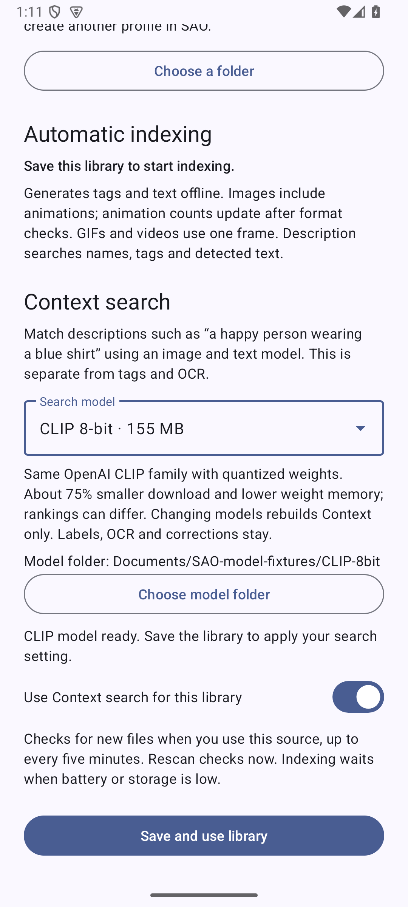
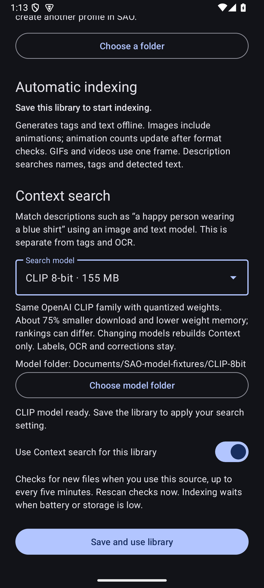

# Local Sticker extension

> [!NOTE]
> Source implementation and extension build commands now belong to [SAO-extensions](https://github.com/nijuyonkadesu/SAO-extensions). Install and update the APK from SAO’s Media sources page. [Distribution and build instructions](extension-catalog.md).

Install SAO and the matching `local-sticker.apk`, then choose **Settings → Media sources → Add source → Local Sticker**. Give the profile a name, choose an **Import using** method, add and name your collections, then save. **Folder picker** remains the default; **Photo picker** and **Files picker** select individual images and videos. Repeat to create independent profiles. Their names appear in SAO's existing source switcher.

The extension recursively indexes supported JPEG/PNG/WebP/GIF/HEIF/AVIF images and MP4/WebM/MKV videos. Originals remain with their chosen storage provider. Folder grants, indexed metadata, corrections and models belong exclusively to the extension; SAO receives public profile references, pages and read-only media streams. There is no all-files permission. Internet access is used for the explicit Context-model download, never to upload images or search text; ML Kit's CCT telemetry backend and upload components are removed from the manifest.

Mark **NSFW source** in the profile section when appropriate. SAO hides that entire source while **NSFW Mode** is off. This is an explicit user choice, defaults off and does not run image classification or trigger reindexing.

## Import methods

Local Sticker 1.6.2 also accepts [media shared through SAO](media-imports.md). Editing its source opens these settings directly: Profile, Collections, selected-file imports, Processing and Context search share one scroll surface, separated by colored headings and dividers. Shared originals are copied without overwriting existing files, registered directly and analyzed off the main thread. Existing folder/selected-media collections keep their in-place behavior.

- **Folder picker:** recursively discovers supported media in the granted folder. New files are picked up during the normal throttled scan.
- **Photo picker:** Android’s multi-select image/video picker opens its **Albums** tab when supported. **Cloud photo settings** opens the Android provider selector directly; choose Google Photos and allow access there. Google Photos must be installed and enabled as the eligible cloud media provider. Android supplies selected-item access, not a live grant to a whole Google Photos album. Select the items you want; use **Add photos and videos** on that collection to append more later. Local Sticker 1.4.1 also exposes **Add whole folder** directly below the import action: grant one local directory to include all supported media and subfolders, without changing your default picker. This adds a separate folder collection; it does not convert or expand a cloud album grant.
- **Files picker:** selects multiple supported media files from a document provider using `ACTION_OPEN_DOCUMENT`.

The last chosen import method is an explicit extension setting. Selected items retain read grants and are indexed in bounded batches without copying originals into the extension. Cloud availability and downloads are controlled by the provider. Photo-picker providers may expose numeric filenames rather than the original filename. Original bytes are streamed through the existing host-owned media cache. Duplicate selections are ignored; appending media preserves corrections and invalidates stale browsing cursors. Collection removal releases grants only when no other library or model folder needs them.

Android limits retained photo-picker access to 5,000 media grants; choose folder access for a large on-device library. Missing access or unavailable providers appear in collection progress and can be retried with a rescan. [Android photo-picker contract](https://developer.android.com/training/data-storage/shared/photo-picker).

## Automatic indexing and corrections

Bundled ML Kit models generate general image labels and Latin-script OCR without Google Play services, a model picker or per-file approval. GIFs, animated WebP and videos use a representative frame. The general labeler recognizes objects/concepts; it is not a dedicated anime, character or meme-emotion model. Context search adds separate CLIP embeddings; named people/places are not supported.

Files are available by name as soon as discovered; generated metadata becomes searchable as processing progresses. SAO observes index notifications only while the floating picker is visible. Matching updates merge into the existing result list while preserving the focal item. A new search uses the current full index and normal sort order. Closing the picker unregisters its observer; no result polling or idle source binding is used.

Each collection card shows its phase, images (including the detected animation count), videos, and separate processed/remaining/failed counters for labels/OCR and Context. Discovery shows a growing count and indeterminate progress; analysis shows determinate progress across both enabled stages. **Pause/Resume** preserves that album's checkpoints while other albums continue. **Restart** confirms a fresh scan and reanalysis of only that album, preserving corrections and originals. Library-wide pause/resume and rescan remain available below the cards. Folder-access failures and failed media are reported separately.

**Time remaining:** the library and the currently processing collection show an approximate ETA after at least three measurements of each needed stage. Labels/OCR and Context have separate rolling windows of the last 32 file costs, including cloud reads and model startup. The library estimate excludes paused collections. Scanning, queued albums and warm-up have explicit messages; completion/pause hides the estimate. Timing lives only in memory, updates from work events (normally at most once per second), and resets after worker/process restarts. There is no countdown polling, preference spam or added progress database writes.

Choose **Browse and correct metadata** to add a title, description, tags/emoji or text. Local Sticker 1.6.3 keeps generated tags and recognized text visible separately and searches the union of automatic data and user additions. Editable tag/text fields contain only those additions; duplicates are removed. **Reset to automatic metadata** removes only user additions. Upgrading rebuilds existing search documents in bounded batches without regenerating labels or embeddings. Rescans and changed-file analysis preserve corrections and never write into original files. Context uses image content, so editing tags does not rewrite its embedding.

Indexing runs in one-time, battery/storage-constrained WorkManager jobs. Directory checkpoints and analysis state survive process death and constrained job restarts. Labels/OCR and Context are interleaved in bounded batches, so early files become semantically searchable before all OCR finishes; one model closes before the next loads. Work yields between bounded passes and stops on cancellation. There are no periodic scan jobs, keepalive foreground services, screen-on flags or custom wake locks. Android/WorkManager holds its normal execution wake lock only during scheduled work; this is unrelated to floating-icon recovery. Removing folder access does not erase existing metadata. Choose the folder again to restore access, then rescan.

Initial save starts a scan. A newly visible browsing session or changed query may check for new/changed files, with a five-minute cooldown. Capability reads, later pages and reactive index updates never start scans. Configured folders also receive an Android-managed check about every six hours; paused collections do not process. **Rescan folders** checks immediately and retries failed files. Unchanged files retain prior analysis. A failed traversal cannot prune existing entries. Analysis failures remain visible and do not prevent corrections or exporting readable originals.

## Context search

In the extension settings, choose a **Search model**, then **Choose model folder**. Pick a dedicated folder on this device, for example `Documents/SAO Models/CLIP 8-bit`. Existing compatible files are verified and reused; otherwise press **Download model**. Enable **Use Context search for this library** and save. Context becomes that profile's default mode. Description, filename, path and OCR still work without either optional model.

| Model | Download | Trade-off |
| --- | --- | --- |
| Immich default | 609 MB | Original `ViT-B-32__openai` FP32 encoders and matching tokenizer |
| CLIP 8-bit | 155 MB | The same OpenAI ViT-B/32 family with quantized image/text weights; about 75% less download storage and lower weight memory, with possible ranking differences |

Model choice belongs to each profile. Files can be reused across profiles; each profile keeps its own Context index. Changing model and saving rebuilds that index automatically, preserving labels/OCR, corrections and originals. Embeddings from different encoders are never compared. A phrase such as “happy person wearing a blue shirt” is compared with image content; matching generated tags are unnecessary. Whole phrases and emoji go through the text encoder intact. Both choices use a 77-token byte-level tokenizer, bicubic 224-pixel resize/center crop, CLIP normalization and normalized 512-dimensional vectors with cosine ranking. Android decoding and representative video/GIF frames can differ from server previews, so identical Immich rankings are not guaranteed.

**Model files survive uninstalling.** The Android folder picker grants access to user-owned shared storage, rather than `Android/data` or internal app directories. After reinstalling, choose the same model and folder to verify/reuse the files without another download. Android removes the old access grant on uninstall, so selecting the folder again is necessary. Library profiles, indexed metadata and corrections remain app-private and are not backed up by this model-folder feature. Existing internal downloads from version 1.1 continue working; choosing a folder moves them out without network access, removing the old private weights only after the external pair passes verification. New downloads always go directly into the selected folder. Do not move/delete the files while using Context; reselect a moved folder to restore access.

Only the two pinned encoder layouts are accepted, rather than arbitrary ONNX models. To download on a computer, retain the relative paths from the matching repository inside the selected folder: [Immich FP32](https://huggingface.co/immich-app/ViT-B-32__openai/tree/a857c8de2c07bbcfa6646adfcf31b798845afa1e) needs `visual/model.onnx`, `textual/model.onnx` and `textual/tokenizer.json`; [CLIP 8-bit](https://huggingface.co/Xenova/clip-vit-base-patch32/tree/d15189d7028b43f1d3e65039190477f6af591c2a) needs `onnx/vision_model_uint8.onnx`, `onnx/text_model_uint8.onnx` and `tokenizer.json`. Select a locally stored, seekable folder. Read-only folders can supply existing models; downloads need write access. No all-files permission or internal staging copy is used.

The smaller option uses U8U8 quantization to avoid the signed 8-bit saturation issue documented by [ONNX Runtime](https://onnxruntime.ai/docs/performance/model-optimizations/quantization.html#when-and-why-do-i-need-to-try-u8u8). Cross-CPU tests require exact tokenizer IDs and preprocessing hashes, with separate numerical tolerances for 8-bit output. Its retrieval recall has not been benchmarked against FP32; choose the default FP32 pair when preserving the original model precision is the priority. Stored vectors remain 512 full-precision float32 values in both modes, and ranking is exhaustive cosine search, without an approximate neighbor index.

Pinned revisions and SHA-256 hashes are checked before use. Downloads support pause/resume and bounded retries; corrupt existing files are not silently overwritten. Reuse is revalidated when the folder is selected, and size/modification metadata detects subsequent changes. No inference request uses the network; ONNX telemetry is disabled.

Opening settings, listing files, OCR and ordinary metadata searches do **not** load either CLIP encoder. The image encoder loads only for indexing, closes between analysis phases, and closes when indexing finishes, pauses or is cancelled. The text encoder loads lazily on the first nonblank Context query, reuses its weights for nearby queries, and closes after **30 seconds idle**, on a model/folder switch, on Android memory-pressure callbacks, or source-service destruction. Sessions use two CPU threads with idle spinning disabled. The granted descriptor is mapped read-only for ONNX session creation and explicitly unmapped immediately afterward, avoiding a whole-model heap byte array or waiting for garbage collection. Native sessions and tensors are closed explicitly; Android's allocator may retain some freed pages for reuse. Query results are not cached.

Embeddings live in the extension's private SQLite database and are invalidated when a file changes. Each vector uses 2 KiB before SQLite overhead: 120,000 indexed files require about 234 MiB for raw vectors alone. A synthetic 1,000-row embedding table matching this schema occupied 3.92 MiB with 4 KiB SQLite pages (raw vectors: 1.95 MiB), before separate media/FTS/OCR metadata. Actual database growth depends on page size and free space. Ranking streams internal batches of at most 256 vectors and retains at most 61 candidates, using a small native dot-product kernel. The Android 15 emulator ranked 120,000 synthetic vectors for the first 60 results in about 0.66 seconds with a warm text encoder, excluding index creation; phone timings vary. Pagination uses score/ID cursors, with no hidden result cap. All indexing, ranking, model loading and file work run off the main thread.

 

## Search capabilities

| Control | Local Sticker behavior |
| --- | --- |
| Context (default when enabled) | CLIP semantic similarity, including whole phrases and emoji input; requires the downloaded model |
| Description (fallback default) | Word-prefix matching across names, title, description, effective tags and OCR; terms combine with AND |
| Filename | Literal filename substring |
| Full path or folder | Literal collection/relative-path substring |
| OCR | Effective recognized/corrected text only |
| Media | All, images or videos |
| Emoji | Text embeddings in Context; literal metadata/tag matching in Description and tag filters, including common label aliases such as Smile → 😊. Unicode joiners/skin tones are retained |
| Lucky | Random sample from eligible indexed files |
| Sequence | Saved/modified time descending, with stable ties and the exact held item |
| People, Places | Disabled through capability declarations |

Search text stays on the device and is evaluated inside the extension. The metadata database uses SQLite FTS4 for word search and escaped literal matching for emoji/punctuation. Metadata results are paginated by saved time/ID; Context results use score/ID. New searches read the current index. Original/preview bytes use SAO's shared cache, including shared original variants for animations and video exports.

## Building and testing

```sh
./gradlew :local-extension:assembleRelease :local-extension:assembleDebugAndroidTest
```

The ML runtime dominates APK size. Standalone APKs are produced separately for `arm64-v8a`, `armeabi-v7a` and `x86_64`; sign them with the same key as SAO. Use the x86_64 debug APK on the emulator. Local-source classes/models are absent from SAO's production dependencies. There is no dependency on Rays or copied Rays APK content.

The optimized ARM64 APK is about 28 MiB, with compressed native libraries; installation extracts the native runtimes. The optional FP32 or 8-bit weights are downloaded separately into a user-selected folder; neither is bundled in the APK. ML Kit's manifest-discovered component constructors, the native scorer entry points and ONNX Runtime's JNI types are explicitly retained during shrinking, following [Microsoft's required R8 rule](https://onnxruntime.ai/docs/build/android.html#note-proguard-rules-for-r8-minimization-android-app-builds-to-work). The numerical kernel uses NDK 28.2.13676358/CMake 3.22.1. If Kotlin 2.4.20 reports the incremental-cache assertion `Class name must not be root`, rebuild with `-Pkotlin.incremental=false`; this is a compiler-cache workaround, not an application runtime setting.

Local tests cover indexing, per-album progress and controls, migration, corrections, model downloads/recovery, official tokenizer and encoder reference outputs, native numerical accuracy, 120,000-vector ranking and cancellation. Cross-app tests cover the unchanged host API and real settings controls. Tests use synthetic/private fixtures and public model files, never personal Immich media. Settings are visually checked in light/dark themes.

The current local run passes 32 instrumentation cases (30 functional checks and two opt-in fixture helpers skipped). Two host model-folder/profile-recovery checks passed after actually uninstalling and reinstalling the signed optimized extension; the model files survived and were reselected without downloading again. These numeric checks do not establish retrieval recall equivalence between 8-bit and FP32 models.

The picker update adds three selected-media instrumentation checks: all supported media formats, append/deduplication with preserved corrections, and bounded discovery checkpoints. The complete local indexing subset passes 15 functional checks (plus two skipped fixture helpers). Host checks cover the real system photo/folder pickers, persistent grants, named-collection reopening, byte-exact exports, Files picker launch/cancel, optional/custom emoji UI and the no-source screen. The signed optimized extension is used for the real picker journeys.

The local instrumentation suite uses synthetic, private documents and bundled test media. Cross-app tests can prepare a synthetic local profile explicitly:

```sh
adb shell am instrument -w -e prepareLocalFixture true \
  -e class one.njk.sao.extension.local.LocalLibraryDeviceTest#prepareHostFixture \
  one.njk.sao.extension.local.test/androidx.test.runner.AndroidJUnitRunner
adb shell am instrument -w -e class one.njk.sao.floating.LocalSourceDeviceTest \
  one.njk.sao.test/androidx.test.runner.AndroidJUnitRunner
adb shell am instrument -w -e removeLocalFixture true \
  -e class one.njk.sao.extension.local.LocalLibraryDeviceTest#removeHostFixture \
  one.njk.sao.extension.local.test/androidx.test.runner.AndroidJUnitRunner
```

For Context fixtures, download through the extension settings or install the pinned model files into the debug extension's `no_backup/clip-default` directory with a `ready` marker containing `ClipModels.MODEL`, then pass `-e clipModelFixtures true` to `LocalContextDeviceTest`. Add `-e localScaleCheck true` for the 120,000-item test. `LocalModelSetupDeviceTest` uses `-e externalModelFixtures true` with public files under `Documents/SAO-model-fixtures/{Immich-default,CLIP-8bit}` to exercise real folder grants, old-download migration and model switching. `QuantizedContextDeviceTest` checks 8-bit reference outputs, cross-model isolation and unloading. `ClipDownloadDeviceTest` requires `-e verifyModelDownload true`, that owned shared test folder, and downloads only its public tokenizer. Prepare the cross-app Context fixture with `-e prepareLocalFixture true -e prepareContextFixture true` before running `LocalContextSourceDeviceTest`; `-e removeLocalFixture true` cleans that owned fixture afterward. [Reference generation](../tools/generate-clip-reference.py) (`--quantized` for the lightweight pair) uses the pinned official models and bundled synthetic image, not guessed classifications.

Primary references: [Immich searching](https://docs.immich.app/features/searching/), [pinned model files](https://huggingface.co/immich-app/ViT-B-32__openai/tree/a857c8de2c07bbcfa6646adfcf31b798845afa1e), [Immich visual preprocessing](https://github.com/immich-app/immich/blob/main/machine-learning/immich_ml/models/clip/visual.py), [text tokenization](https://github.com/immich-app/immich/blob/main/machine-learning/immich_ml/models/clip/textual.py), [ONNX Runtime Android](https://onnxruntime.ai/docs/tutorials/mobile/deploy-android.html), [folder grants](https://developer.android.com/training/data-storage/shared/documents-files), [WorkManager constraints](https://developer.android.com/develop/background-work/background-tasks/persistent/getting-started/define-work), [bundled labeling](https://developers.google.com/ml-kit/vision/image-labeling/android), [bundled OCR](https://developers.google.com/ml-kit/vision/text-recognition/v2/android), [FTS4 syntax](https://www.sqlite.org/fts3.html).

## Google Photos album access

Android’s native picker can browse albums exposed by the selected cloud provider, but returns grants for selected media items rather than a persistent folder/album tree. It cannot subscribe Local Sticker to future additions to a Google Photos album. The available albums are controlled by Google Photos; SAO cannot force all custom albums to appear. Selected items form a named Local Sticker collection and can be appended later through **Add photos and videos**.

On supported devices, use **Import using → Photo picker → Cloud photo settings** for the one-time provider setup, then **Add photos and videos → Albums**. Android 15 / R extension 12 adds the preferred-tab API; older pickers retain their default tab. Google documents cloud-photo access on Android 13+; if needed, enable **Google Photos → Photos settings → Apps & devices → Google Photos access → Photo picker**.

The separate Google Photos web Picker API would require OAuth, a selection session and downloading selected bytes; it does not provide an Android folder grant. The Library API only lists app-created albums/media since March 2025. These do not supply the requested live native-album source.

Sources: [Google Photos setup](https://support.google.com/photos/answer/14442861?hl=en), [Android cloud providers and album browsing](https://developer.android.com/guide/topics/providers/cloud-media-provider), [native cloud settings action](https://developer.android.com/reference/android/provider/MediaStore#ACTION_PICK_IMAGES_SETTINGS), [preferred Albums tab](https://developer.android.com/reference/androidx/activity/result/PickVisualMediaRequest.Builder#setDefaultTab(androidx.activity.result.contract.ActivityResultContracts.PickVisualMedia.DefaultTab)), [Picker sessions](https://developers.google.com/photos/picker/guides/sessions), [Library API restrictions](https://developers.google.com/photos/support/updates).

Local Sticker 1.5 validation: five ETA JVM checks and 18 functional Android checks pass (two opt-in fixture helpers are skipped), including real worker measurements/cancellation, progress rendering, persisted selection handling and the Albums launch request. The optimized APK also passed the real cloud-settings → Albums → selection/grants/export journey. Context-stage ETA weighting is tested with synthetic costs; the optional real quantized-model check was skipped because its model fixture was unavailable. This run did not inspect a personal Google Photos or Immich library.
