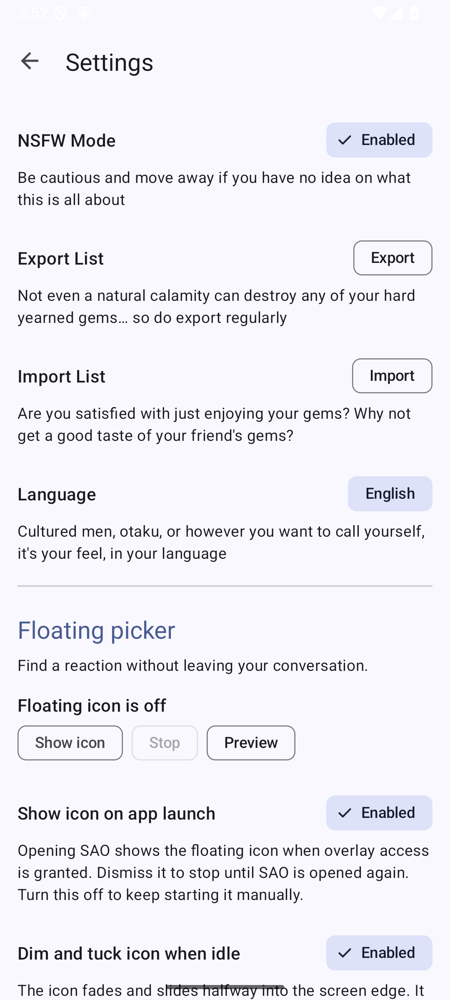

# Floating picker previews

Captured on the Android 15 emulator using bundled samples and a localhost Immich fixture. The emulator has no native hook framework; native delivery was checked separately with recording APK probes and on the user's phone.

| Carousel and automatic copy | Context search selector | Inline floating settings |
| --- | --- | --- |
|  |  |  |

The optional sequence view follows Immich's Photos ordering and labels each card with its upload time. The shared hold delay and sequence toggle are inline in settings.

| Sequence and upload time | Sequence and shared hold settings |
| --- | --- |
|  |  |

Dock messages sit below the title and above the action buttons. Text rows reserve space when
empty; overflowing labels pause for 1.5 seconds before scrolling. Opening search selects the
whole existing query, and Lucky's icon follows the Material light/dark theme.

| Dock text above actions | Search selection in dark mode | Accessibility instructions |
| --- | --- | --- |
|  |  |  |
